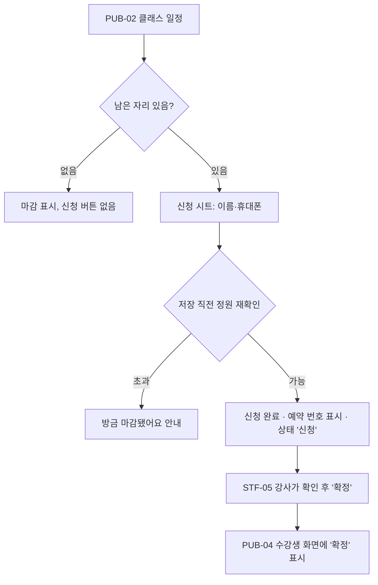
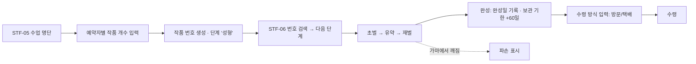
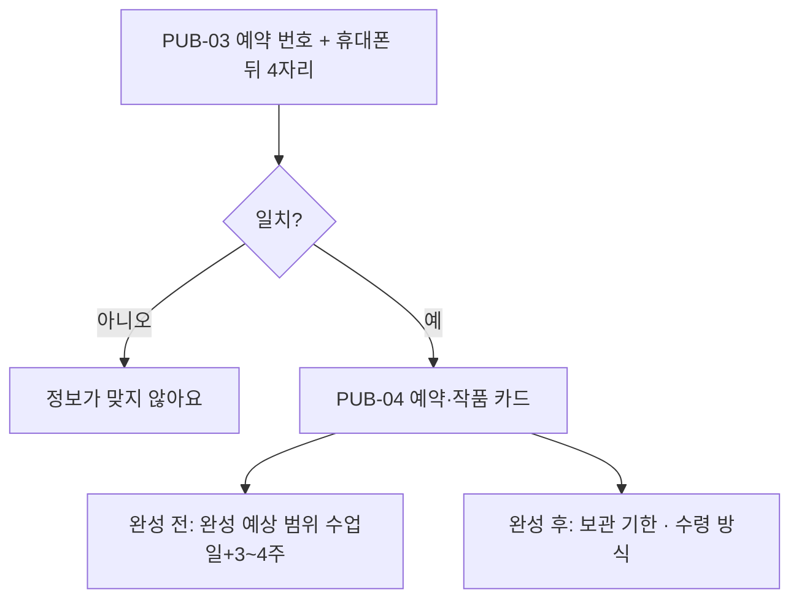
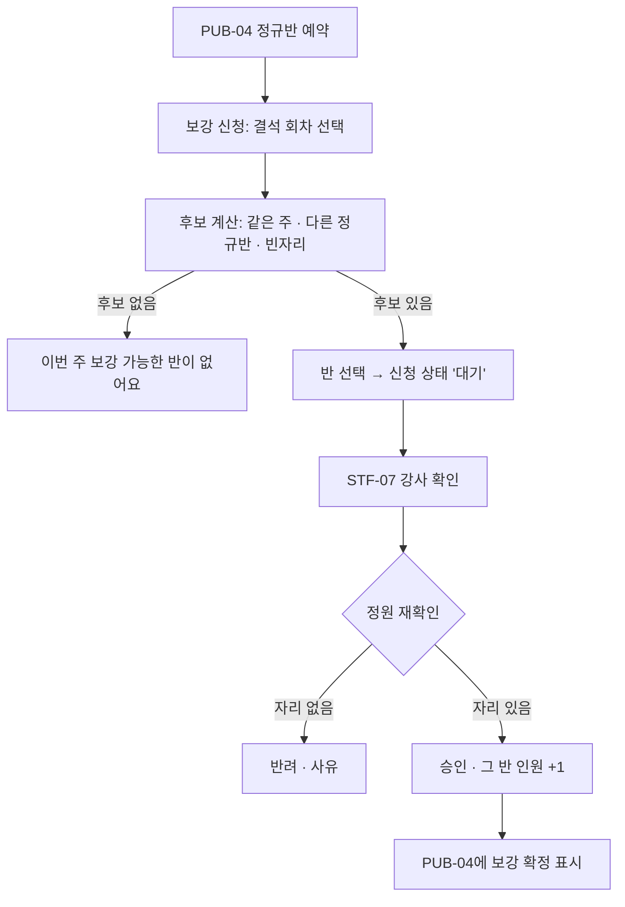
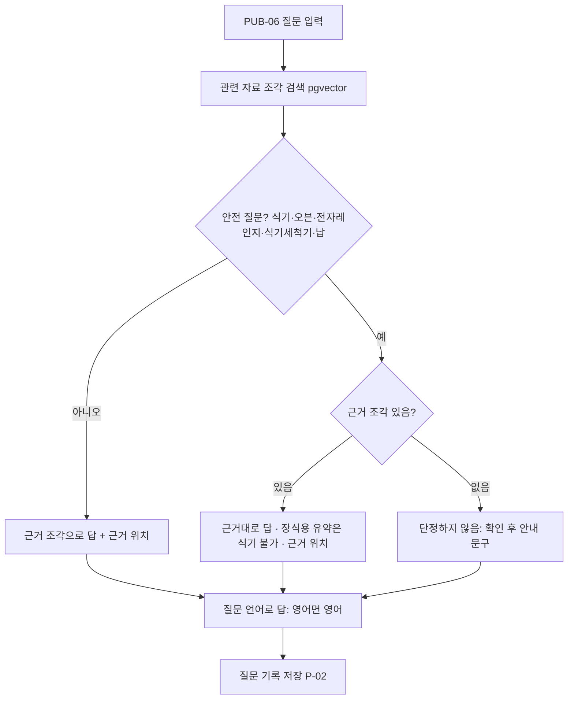
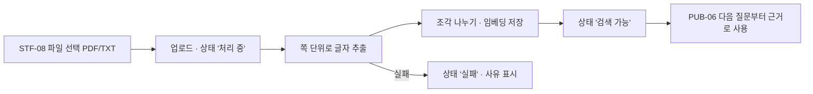
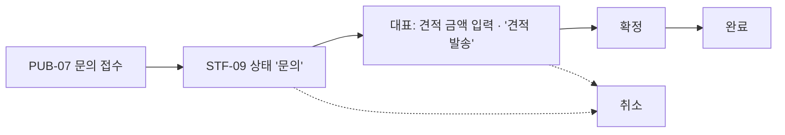
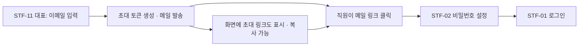
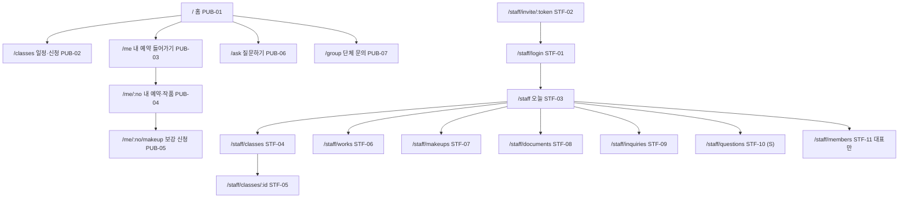

# 02. 기획서 — 흙과불 도자기공방 (고객사 11)

| 항목 | 내용 |
| --- | --- |
| 문서 목적 | 누가·언제·왜 쓰는지 정하고, 역할별 권한·전체 화면·사용자 흐름·사이트맵과 **오늘 만들 기능 / 미룰 기능**을 정한다 |
| 상태 | **Approved** (2026-11-13, 가정 A-01~A-06 포함 승인) |
| 포함 단계 | STEP 2 역할·권한 / STEP 3 화면 목록 / STEP 4 사용자 흐름 / STEP 5 사이트맵 |
| 근거 | [01-requirements.md](01-requirements.md) (Approved, 요구사항 R-01~R-14, 제안 P-01~P-05, 가정 U-01~U-08), [해커톤_정리.md](../../해커톤_정리.md) |
| 다음 문서 | `03-spec.md` (화면설계·ERD·디자인 규칙·구현 순서) |

> 표기: **[확인]** 원문·승인된 01 문서 근거 / **[가정]** 이번 문서에서 새로 세운 가정(승인 필요) / **[제안]** 내 추천

---

## 1. 사용자와 사용 장면

| 사용자 | 언제 | 어디서(기기) | 왜 | 관련 요구 |
| --- | --- | --- | --- | --- |
| 수강생(원데이) | 수업 전 신청, 수업 후 3~4주 동안 | 휴대폰 | 자리 확인·신청, "제 컵 언제 나와요?" | R-01, R-05, R-06 |
| 수강생(정규반) | 결석이 생긴 주 | 휴대폰 | 같은 주 다른 반으로 보강 신청 | R-08 |
| 수강생(외국인 포함) | 수업 중·후 | 휴대폰 | 흙·유약·식기 사용 질문 (영어 포함) | R-09~R-11 |
| 단체 문의자 | 워크숍 계획 시 | 휴대폰·PC | 단체 클래스 문의 | R-13 |
| 강사(류) | 수업 전후, DM 확인 시 | 휴대폰(수업 중) / PC(목록) | 예약 확정, 작품 단계 기록, 보강 처리 | R-02, R-04, R-08 |
| 강사(권) | 수업 중, 자료 갱신 시 | 휴대폰 / PC | 질문 근거 찾기, 수업 노트 올리기 | R-09, R-12 |
| 대표 | 가마 가동 판단, 단체 견적, 직원 관리 | PC 위주 | 가마 대기 수 확인, 견적 관리, 직원 초대 | P-01, R-13, R-14 |

**장면 예시 (고객 소개의 토요일 장면 기준)**
1. 토요일 원데이 8명 수업이 끝나면 강사가 휴대폰으로 그 수업의 예약자별 작품을 등록한다 → 작품마다 **번호**가 생기고, 이름표에 번호를 적는다. 이름표가 떨어져도 번호로 찾는다. (R-04)
2. 한 달 뒤 수강생이 DM 대신 "내 작품 보기"에서 예약 번호 + 휴대폰 뒤 4자리로 들어와 "재벌 중 · 완성 예상 12/8~12/15"를 본다. (R-05, R-06)
3. 다른 수강생이 "청자 유약이랑 분청 유약 뭐가 달라요? 전자레인지 돼요?"를 질문 화면에 입력 → 답과 함께 "온결 카탈로그 p.6" 같은 근거가 뜨고, 전자레인지 부분은 근거가 있을 때만 답한다. (R-09, R-10)

---

## 2. 역할과 권한 (STEP 2)

### 2-1. 역할 정의

| 역할 코드 | 이름 | 로그인 | 근거 |
| --- | --- | --- | --- |
| `OWNER` | 대표 | 이메일+비밀번호 (시드로 1개 생성) | [확인] 01 U-07, R-14 |
| `STAFF` | 강사 | 이메일+비밀번호 (대표 초대 메일로 설정) | [확인] 01 U-07, R-14 |
| 수강생 | 수강생 | 로그인 없음. 예약 번호 + 휴대폰 뒤 4자리로 **자기 예약만** 조회 | [확인] 01 U-03 |
| 방문자 | 비로그인 누구나 | 없음 | 신청·질문·단체 문의 |

- 단체 문의자는 별도 역할로 두지 않는다. 방문자가 문의 폼을 쓰는 것으로 충분하다. [제안]

### 2-2. 권한표

○ 가능 / △ 자기 것만 / × 불가

| 기능 | 방문자 | 수강생 | 강사 STAFF | 대표 OWNER | 근거 |
| --- | --- | --- | --- | --- | --- |
| 클래스 일정·남은 자리 보기 | ○ | ○ | ○ | ○ | R-01 |
| 클래스 신청 (정원 초과 시 차단) | ○ | ○ | ○ (DM·네이버 대리 등록) | ○ | R-01 |
| 예약 확정·취소 | × | × | ○ | ○ | R-02 |
| 클래스 일정 등록·수정 | × | × | ○ | ○ | R-01 [가정] |
| 작품 등록·단계 변경·파손 표시 | × | × | ○ | ○ | R-04, U-04 |
| 작품 단계·완성 예상 범위 보기 | × | △ | ○ | ○ | R-05, R-06 |
| 보강 신청 | × | △ (정규반 본인) | ○ (대리) | ○ | R-08 |
| 보강 승인·반려 | × | × | ○ | ○ | R-08 |
| 자료 질문(AI) | ○ | ○ | ○ | ○ | R-09 |
| 자료 올리기·삭제 | × | × | ○ | ○ | R-12 [가정: 권 강사가 노트 작성자] |
| 단체 문의 등록 | ○ | ○ | ○ | ○ | R-13 |
| 단체 문의 조회·메모 | × | × | ○ | ○ | R-13 |
| 단체 견적 금액·상태 변경 | × | × | × | ○ | R-13 [가정: "견적을 따로 내요"를 말한 사람이 대표] |
| 가마 대기 현황 보기 | × | × | ○ | ○ | P-01 |
| 질문 기록 보기 | × | × | ○ | ○ | P-02 |
| 직원 초대·비활성화 | × | × | × | ○ | R-14 |

**권한을 지키는 곳 [제안]**: 백엔드 API에서 검사한다(화면에서 버튼만 숨기지 않는다). 수강생 조회는 예약 번호와 뒤 4자리가 모두 맞을 때만 그 예약의 데이터만 돌려준다.

---

## 3. 전체 화면 목록 (STEP 3)

- 현재 존재하는 화면은 `/`(헬스 확인) 하나뿐이라 **모든 화면이 신규**다. `/` 는 홈으로 바꾸고 헬스 확인은 API로만 남긴다. [제안]
- 등록·수정은 별도 페이지 대신 **드로어(PC)/하단 시트(휴대폰)** 로 통합해 화면 수를 줄인다. [제안]
- 우선순위: **M** 오늘 / **S** 시간 남으면 / **L** 미룸

### 3-1. 공개 화면 (방문자·수강생, 휴대폰 우선)

| 화면 ID | 화면명 | 경로 | 목적 | 접근 | 주요 기능 | 상태 | MVP |
| --- | --- | --- | --- | --- | --- | --- | --- |
| PUB-01 | 홈 | `/` | 들어오는 입구 | 누구나 | 4개 메뉴(클래스 신청·내 작품·질문하기·단체 문의) | 신규 (기존 헬스 화면 대체) | M |
| PUB-02 | 클래스 일정·신청 | `/classes` | 자리 확인 후 신청 | 누구나 | 날짜별 일정, 종류(일반/물레), **남은 자리/정원**, 마감 표시, 신청 하단 시트(이름·휴대폰), 완료 시 **예약 번호** 표시 | 신규 | M |
| PUB-03 | 내 예약 들어가기 | `/me` | 수강생 확인 | 수강생 | 예약 번호 + 휴대폰 뒤 4자리 입력 | 신규 | M |
| PUB-04 | 내 예약·작품 | `/me/[reservationNo]` | 내 상태 한눈에 | 수강생(본인) | 예약 상태(신청/확정/취소), 작품 카드(번호·**단계 막대**·완성 예상 범위·수령 방식·보관 기한), 정규반이면 "보강 신청" 버튼 | 신규 | M |
| PUB-05 | 보강 신청 | `/me/[reservationNo]/makeup` (하단 시트로도 가능) | 결석 회차 보강 | 정규반 수강생 | 결석 회차 선택 → **같은 주·다른 정규반·빈자리** 후보만 표시 → 신청 → "강사 확인 후 안내" | 신규 | M |
| PUB-06 | 질문하기 | `/ask` | 흙·유약·기법 질문 | 누구나 | 질문 입력, 답변 + **근거(자료명·쪽)**, 안전 질문은 근거 없으면 "확인 후 안내", 영어 질문은 영어 답 | 신규 | M |
| PUB-07 | 단체 문의 | `/group` | 워크숍 문의 | 누구나 | 단체명·담당자·연락처·희망 날짜·인원·내용 → 접수 완료 | 신규 | M |

### 3-2. 직원 화면 (`/staff`, 강사·대표)

| 화면 ID | 화면명 | 경로 | 목적 | 접근 | 주요 기능 | 상태 | MVP |
| --- | --- | --- | --- | --- | --- | --- | --- |
| STF-01 | 직원 로그인 | `/staff/login` | 직원 진입 | 직원 | 이메일·비밀번호 | 신규 | M |
| STF-02 | 비밀번호 설정 | `/staff/invite/[token]` | 초대 받은 직원 첫 설정 | 초대 받은 사람 | 토큰 확인, 비밀번호 2회 입력, 만료·사용된 토큰 안내 | 신규 | M |
| STF-03 | 오늘 (대시보드) | `/staff` | 할 일 한눈에 | 직원 | 오늘 수업과 인원, **확정 안 된 신청 수**, 보강 대기 수, 새 단체 문의 수, **가마 대기 n/30**(P-01), 보관 기한 지난 작품 수(R-07) | 신규 | M (가마·보관 칸은 S) |
| STF-04 | 클래스 일정 | `/staff/classes` | 일정 관리 | 직원 | 주간 일정 목록, 일정 등록·수정 드로어(원데이/정규반, 일반/물레 → 정원 자동 8/6, 날짜·시간), 정규반은 4주 한 번에 생성 | 신규 | M |
| STF-05 | 일정 상세 (명단) | `/staff/classes/[id]` | 수업 단위 처리 | 직원 | 예약자 명단·상태, **확정/취소** 버튼(취소 시 환불 비율 표시 R-03), DM·네이버 **대리 등록**(경로 선택), 수업 후 **작품 등록**(예약자별 개수 → 번호 생성) | 신규 | M (환불 표시 S) |
| STF-06 | 작품 목록 | `/staff/works` | 작품 찾기·단계 변경 | 직원 | **번호·이름 검색**, 단계 필터, 휴대폰에서 카드 탭 → "다음 단계로" 버튼, 수령 방식 입력, 파손 표시, 보관 기한 지남 필터 | 신규 | M |
| STF-07 | 보강 신청 | `/staff/makeups` | 보강 처리 | 직원 | 대기 목록, 대상 반의 현재 인원 표시, **승인/반려**(승인 시 정원 재확인) | 신규 | M |
| STF-08 | 자료 관리 | `/staff/documents` | 자료 반영 | 직원 | PDF·텍스트 올리기, 종류(공급처/수업 노트), **처리 상태**(처리 중/검색 가능/실패), 삭제 | 신규 | M |
| STF-09 | 단체 문의 | `/staff/inquiries` | 문의·견적 관리 | 직원(조회), 대표(견적) | 상태별 목록(문의→견적 발송→확정→완료/취소), 상세 드로어(메모, 견적 금액·상태는 대표만) | 신규 | M |
| STF-10 | 질문 기록 | `/staff/questions` | 반복 질문 파악 | 직원 | 최근 질문·답·근거, 근거 없음(확인 후 안내) 필터 | 신규 | S (P-02) |
| STF-11 | 직원 관리 | `/staff/members` | 직원 초대 | **대표만** | 직원 목록, 이메일로 초대(메일 발송 + 초대 링크 복사), 비활성화 | 신규 | M |

- 직원도 질문은 PUB-06(`/ask`)을 함께 쓴다. 따로 만들지 않는다. [제안]
- 작품 상세는 STF-06 안의 드로어로 처리한다(별도 페이지 없음). [제안]

### 3-3. 기능 구분 (요청하신 5분류)

| 분류 | 항목 |
| --- | --- |
| 기존에 구현된 기능 | `GET /api/health`, 헬스 상태 화면 (도메인 기능 아님) |
| 구현 중·일부 구현 | 없음 |
| 요구사항에 있지만 미구현 (오늘 M) | R-01, R-02, R-04, R-05, R-06, R-08, R-09, R-10, R-11, R-12, R-13, R-14 |
| 추가 검토 (S, 시간 남으면) | R-03 환불 비율 표시, R-07 보관 기한, P-01 가마 대기 현황, P-02 질문 기록 |
| 불필요·낮은 우선순위 (미룸) | P-03 준비물, P-04 파손 안내 문안, P-05 후기, 결제·DM/네이버 연동, 사진 업로드, 알림 발송, 노쇼·대기자, 수강료 |

---

## 4. 사용자 흐름 (STEP 4)

### F-1. 수강생: 원데이 신청 → 확정

- 정원은 **신청 + 확정** 인원으로 센다(신청만 해 둔 사람 때문에 초과되지 않게). [가정]
- DM·네이버로 들어온 예약은 강사가 STF-05에서 대리 등록하고 바로 '확정'으로 둘 수 있다. 같은 정원 검사를 탄다.

### F-2. 직원: 수업 후 작품 등록 → 단계 변경 → 수령

- 단계는 앞으로만 한 칸씩 이동, 실수 대비 "한 단계 되돌리기"만 허용. [가정]

### F-3. 수강생: 내 작품 조회

### F-4. 정규반 보강

### F-5. 자료 질문 (안전 분기)

### F-6. 자료 올리기 → 바로 반영

### F-7. 단체 문의 → 견적

- 견적 발송 자체(메일·DM)는 시스템 밖에서 한다. 시스템은 상태와 금액만 기록. [가정]

### F-8. 직원 초대

- 초대 링크는 일정 시간 뒤 만료, 한 번만 사용. 만료 시간은 03에서 정한다.

---

## 5. 사이트맵 (STEP 5)

### 메뉴 구조

| 영역 | 메뉴 (순서) | 휴대폰 | PC |
| --- | --- | --- | --- |
| 공개 | 클래스 신청 · 내 작품 · 질문하기 · 단체 문의 | 홈의 큰 버튼 4개 + 상단 로고 | 상단 가로 메뉴 |
| 직원 | 오늘 · 일정 · 작품 · 보강 · 질문(자료 질문 `/ask`) · 자료 · 단체 문의 · (대표) 직원 | **하단 탭 5개**: 오늘·일정·작품·보강·더보기 | 왼쪽 사이드 메뉴 |

- 휴대폰 하단 탭에 수업 중 자주 쓰는 것(일정·작품·보강)을 둔다. 자료·단체 문의·직원 관리는 "더보기"에. 근거: 01 N-01 "수업 중 휴대폰, 긴 목록·자료는 컴퓨터". [제안]
- `/staff/*` 는 로그인 안 하면 `/staff/login` 으로 보낸다. `/staff/members` 는 대표가 아니면 접근 불가 안내.

---

## 6. 오늘 만들 기능 / 미룰 기능과 이유

### 오늘 만들 기능 (M)

| 순서 | 묶음 | 화면 | 요구 | 이유 |
| --- | --- | --- | --- | --- |
| 0 | 빈 화면 배포 | — | N-02 | 배포 문제를 마지막에 만나지 않게 (CLAUDE.md) |
| 1 | 직원 로그인·초대 | STF-01, 02, 11 | R-14 | 직원 화면 전체의 전제. 사용자 결정 |
| 2 | 일정·신청·확정 | PUB-02, STF-04, 05 | R-01, R-02 | 기본 요구 1, 데이터의 시작점 |
| 3 | 작품 단계·수강생 조회 | STF-05(작품 등록), STF-06, PUB-03, 04 | R-04~R-06 | 대표가 "제일 큰일"이라고 한 것 |
| 4 | 자료 올리기·질문 | STF-08, PUB-06 | R-09~R-12 | 기본 요구 4·5, AI 활용, 안전 규칙 |
| 5 | 보강 | PUB-05, STF-07 | R-08 | 기본 요구 3, 규칙이 명확해 시연 가치 높음 |
| 6 | 단체 문의 | PUB-07, STF-09 | R-13 | 기본 요구 6, 구조 단순 |
| 7 | 대시보드 | STF-03 | — | 흩어진 기록을 한곳에서(진짜 문제 1) |

### 시간 남으면 (S)
R-03 환불 비율 표시 → P-01 가마 대기 n/30 → R-07 보관 기한 → P-02 질문 기록 (이 순서. 가마 대기는 가산점 근거가 가장 뚜렷함)

### 미룰 기능 (L)과 이유

| 기능 | 미루는 이유 |
| --- | --- |
| 준비물 목록 (P-03) | 고객이 "실제 수량이 달라지는 경우를 어떻게 반영할지 봐야" 한다고 해 기준 미정 |
| 파손 안내 문안 (P-04) | 보상 기준(재제작/환불)이 미정이라 문안이 약속처럼 읽힐 위험 |
| 후기 (P-05) | 항목 미정 |
| 결제·입금, 네이버·인스타 연동, 알림톡 | 외부 계약·API 필요, 1일 범위 초과 |
| 사진 업로드 | 고객이 부담 우려 |
| 노쇼·대기자·수강료·할인 | 고객 기준 없음 (01 U-01, U-02) |

### 위험과 줄이는 방법 [제안]
- **남은 시간 대비 M 범위가 크다.** 각 묶음을 "동작하는 최소"로 먼저 만들고 꾸미기는 마지막에. 시간이 모자라면 7 → 6 순으로 줄이고, 1~5는 지킨다.
- **메일 발송**: 키가 없거나 실패해도 초대 링크 복사로 시연 가능하게 만든다.
- **공급처 PDF 4종 없음**: 지금은 수업 노트(80쪽)만 있다. PDF가 없으면 R-09의 "공급처 자료 근거" 시연이 약해진다 → 위치 확인 또는 새로 준비 필요.

---

## 7. 이번 문서의 가정과 확인 질문

| ID | 가정 | 확인 |
| --- | --- | --- |
| A-01 | 정원은 '신청'+'확정' 인원으로 센다 | 승인 |
| A-02 | 단체 견적 금액·상태 변경은 대표만, 강사는 조회·메모 | 승인 |
| A-03 | 자료 올리기·삭제는 강사·대표 모두 | 승인 |
| A-04 | 작품 단계는 한 칸씩 앞으로, 되돌리기 한 칸만 | 승인 |
| A-05 | 정규반은 일정 등록 시 4주치를 한 번에 생성, 수강생은 반 단위로 신청 | 승인 |
| A-06 | 견적 발송은 시스템 밖, 시스템은 상태·금액 기록만 | 승인 |

질문
1. 위 가정 A-01~A-06으로 가도 되나요?
2. 화면 18개(공개 7, 직원 11) 구성과 M/S/L 구분에 동의하나요?
3. 공급처 PDF 4종은 어디 있나요? (없으면 03 단계 전에 다시 만들지 정해야 함)
