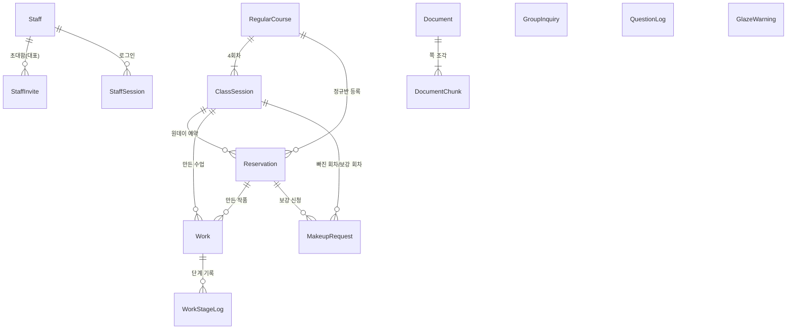

# 03. 기능 명세서 — 흙과불 도자기공방 (고객사 11)

| 항목 | 내용 |
| --- | --- |
| 문서 목적 | 02 기획서의 화면·흐름을 **만들 수 있는 수준**으로 구체화: 화면설계, 데이터(ERD), 규칙과 지키는 곳, 권한, AI 역할, API, 디자인 규칙, 구현 순서 |
| 상태 | **Approved** (2026-11-13, B-01~B-05·P-06 승인, 디자인은 8절) |
| 포함 단계 | STEP 6 화면설계 / STEP 7 ERD / STEP 8 디자인 규칙 / STEP 9 구현 계획 |
| 근거 | [01-requirements.md](01-requirements.md) (Approved), [02-plan.md](02-plan.md) (Approved), `sample-data/README.md`, 엑셀 2종 머리글, 현재 코드(`backend/`, `frontend/`) |

> 표기: **[확인]** 승인된 문서·코드·시험 자료 근거 / **[가정]** 이번에 새로 세운 가정(승인 필요) / **[제안]** 내 추천

---

## 1. 시험 자료 현황 (갱신)

01 작성 때 비어 있던 자료가 모두 준비됐다. [확인] `sample-data/README.md`

| 자료 | 파일 | 프로덕트에서 쓰는 곳 |
| --- | --- | --- |
| 공급처 PDF 4종 (166쪽) | `sample-data/suppliers/*.pdf` | 자료 올리기(STF-08) → 질문 근거(PUB-06) |
| 수업 노트 17개 (p.1~p.80) | `sample-data/notes/*.txt` | 같음. `----- p.N -----` 를 쪽 번호로 사용 |
| 클래스 일정·예약 (시트 4개: 클래스일정·예약목록·정규반 출석·보강·단체문의) | `클래스일정_예약목록_2026.xlsx` | **시드 데이터**로 가져오기 |
| 작품 목록 205점 + 가마일지 | `작품목록_2026.xlsx` | **시드 데이터**로 가져오기 |
| 새로 올릴 자료(요구 5 시험) | `업로드시험용/온결유약_제품변경안내_2026-11.pdf` | 시연: 올리기 전/후 답 비교 |

- 엑셀은 사람이 손으로 쓴 형식(제목 줄·안내 줄·색칠·표기 흔들림 "시유", "유약 바름")이다. **가져오기 스크립트에서 정리**한다: 단계 표기 통일, 중복 예약은 가져오되 메모 표시. [제안]
- 엑셀에 수강료가 있지만 01 U-02(금액 필드 없음)를 따른다. 가져오지 않는다.

---

## 2. 화면설계 (STEP 6)

공통: 휴대폰 폭(360px)에서 먼저 맞추고, 직원 목록 화면은 PC 폭(1024px+)에서 표로 넓힌다. [확인] 01 N-01

### PUB-01 홈 `/`
```
┌─────────────────────────┐
│ 흙과불 도자기공방         │
├─────────────────────────┤
│ [ 클래스 신청        > ] │
│ [ 내 작품·예약 보기  > ] │
│ [ 흙·유약 질문하기   > ] │
│ [ 단체 클래스 문의   > ] │
│                         │
│            직원 로그인 → │
└─────────────────────────┘
```
- 버튼 4개는 높이 56px 이상. 오른쪽 아래 작은 "직원 로그인" 링크.

### PUB-02 클래스 일정·신청 `/classes`
```
┌─────────────────────────┐
│ 클래스 신청              │
│ (원데이) (정규반)  ← 탭  │
├─────────────────────────┤
│ 11/15 (토)               │
│ ┌─────────────────────┐ │
│ │14:00 핸드빌딩  일반  │ │
│ │남은 자리 3 / 8 [신청]│ │
│ └─────────────────────┘ │
│ ┌─────────────────────┐ │
│ │16:30 물레      물레  │ │
│ │마감 6 / 6     (회색) │ │
│ └─────────────────────┘ │
└─────────────────────────┘
신청 하단 시트: 이름*, 휴대폰*(010-0000-0000), 인원(1~남은 자리, 기본 1)
 → [신청하기] → 완료: "예약 번호 R4K7Q2 / 강사 확인 후 확정됩니다"
```
| 항목 | 규칙 |
| --- | --- |
| 목록 | 오늘 이후 4주, 휴강 일정 제외, 날짜순 |
| 남은 자리 | 정원 − (신청+확정 인원 합) [확인] A-01 |
| 정규반 탭 | 반(기수) 단위 카드: "화 19:30 물레반 11월기 · 4주 · 남은 자리 2/6" → 반 단위 신청 [확인] A-05 |
| 유효성 | 이름 1~20자, 휴대폰 `010-\d{4}-\d{4}`, 인원 ≥1 |
| 예외 | 저장 순간 정원 초과 → "방금 자리가 찼어요" 후 목록 새로고침. 지난 수업·휴강 신청 불가 |
| 상태 | 불러오는 중(카드 자리 회색), 일정 없음("열린 수업이 없어요"), 서버 오류(다시 시도 버튼) |

### PUB-03 내 예약 들어가기 `/me`
- 입력: 예약 번호(영문·숫자 6자리 또는 엑셀에서 온 10자리 번호), 휴대폰 뒤 4자리. [조회]
- 틀리면 "예약 번호나 휴대폰 뒤 4자리가 맞지 않아요" (어느 쪽이 틀렸는지 알려 주지 않음).
- 성공하면 `/me/[예약번호]` 로 이동, 브라우저 `sessionStorage` 에 확인 토큰 보관(새로고침해도 유지).

### PUB-04 내 예약·작품 `/me/[reservationNo]`
```
┌─────────────────────────┐
│ 최수아 님                │
│ 11/2(일) 14:00 원데이 물레│
│ 상태 [확정]              │
├─────────────────────────┤
│ 내 작품 2점              │
│ ┌─────────────────────┐ │
│ │W260902-01 접시       │ │
│ │●━●━●━●━○━○          │ │
│ │성형 초벌 유약 재벌 완성 수령│
│ │지금: 재벌             │ │
│ │완성 예상 11/23~11/30  │ │
│ │흙 ST-W110 / 유약 OG-C22│ │
│ └─────────────────────┘ │
│ ┌─────────────────────┐ │
│ │W260902-02 컵 ⚠       │ │
│ │식기로 쓰지 마세요:     │ │
│ │장식용 유약(LF-190)     │ │
│ └─────────────────────┘ │
│ (정규반이면) [보강 신청] │
└─────────────────────────┘
```
| 항목 | 규칙 |
| --- | --- |
| 단계 막대 | 6칸, 현재 단계까지 채움. 파손이면 빨간 "파손 — 공방에서 연락드릴게요" |
| 완성 예상 | 완성 전: 수업일+21일 ~ 수업일+28일 (범위) [확인] R-06 |
| 완성 후 | 완성일, 보관 기한(완성일+60일), 수령 방식(방문/택배/미정) [확인] R-07 |
| 식기 경고 | 유약 코드가 **장식용 유약 목록**에 있으면 경고 표시 (P-06, 아래 5절) |
| 보강 | 정규반 예약이고 결석 처리 가능한 회차가 있으면 버튼 노출 |
| 취소·환불 요청 | 원데이·신청/확정·수업 전·요청 없음이면 [취소·환불 요청] → 확인창에 예상 환불(100/50%)·규정·사유(선택, 200자). 요청 후 "환불 요청 접수 · 예상 환불 N%", 승인 후 "취소 완료 · 환불 N%" (R-03) |

### PUB-05 보강 신청 (PUB-04의 하단 시트)
1. 결석할(한) 회차 선택: 내 반의 4회차 중 아직 지나지 않았거나 이번 주인 회차
2. 후보 목록: 같은 주(월~일) · 다른 정규반 · 같은 종류(일반↔일반, 물레↔물레) · 남은 자리 ≥1 · 시작 전 [가정 B-01]
3. 후보 선택 → [보강 신청] → "강사 확인 후 안내드려요" / 상태 '대기'
- 후보 없음: "이번 주에는 보강 가능한 반이 없어요. 공방에 문의해 주세요."
- 같은 회차에 대기·승인된 신청이 이미 있으면 다시 신청 불가.

### PUB-06 질문하기 `/ask`
```
┌─────────────────────────┐
│ 흙·유약·기법 질문         │
│ 예) 전자레인지 써도 돼요? │
├─────────────────────────┤
│ 나: 청자랑 분청 유약 뭐가  │
│     달라요?               │
│ 답: 분청은 유약이 아니라… │
│  근거 ▸ 온결 카탈로그 p.8  │
│       ▸ 수업 노트 07 p.32  │
│ ─────────────────────── │
│ [질문 입력…]      [보내기]│
└─────────────────────────┘
```
| 항목 | 규칙 |
| --- | --- |
| 입력 | 2~500자. 보내는 중 버튼 비활성, "자료를 찾는 중…" |
| 근거 | 답 아래 자료명·쪽을 칩으로. 누르면 그 쪽의 원문 조각을 펼쳐 보여 줌 |
| 안전 질문 | 근거 없으면 고정 문구: "자료에서 확인되지 않아 단정할 수 없어요. 공방에서 확인 후 안내드릴게요." (영어 질문이면 영어로) |
| 대화 | 화면 안에서만 이어 보임(새로고침 시 사라짐). 각 질문은 독립 처리 [제안] |
| 오류 | AI 응답 실패 → "지금 답할 수 없어요. 잠시 후 다시 시도해 주세요." |

### PUB-07 단체 문의 `/group`
- 입력: 단체명*, 담당자*, 연락처*(휴대폰 또는 이메일 중 하나 이상), 희망일, 인원*(1~50), 장소(공방 방문/출장 희망), 내용*(최대 1000자)
- 제출 → "접수됐어요. 대표님이 확인 후 연락드려요." 상태 '문의'로 저장.

### STF-01 로그인 / STF-02 비밀번호 설정
- 로그인: 이메일, 비밀번호. 틀리면 "이메일 또는 비밀번호가 맞지 않아요". 비활성 계정 로그인 불가.
- 설정: `/staff/invite/[token]` → 이메일 표시(수정 불가), 이름*, 비밀번호*(8자 이상), 확인* → 저장 후 로그인 화면.
- 토큰 만료(72시간) 또는 사용됨 → "초대가 만료됐어요. 대표님께 다시 요청해 주세요." [가정 B-02]

### STF-03 오늘 `/staff`
```
┌ 휴대폰 ──────────────────┐
│ 오늘 11/13 (목)           │
│ ┌ 확정 안 된 신청  4 > ┐  │
│ ┌ 보강 대기       2 > ┐  │
│ ┌ 새 단체 문의    1 > ┐  │
│ ┌ 가마  초벌 대기 18/30 ┐ │
│ │      재벌 대기 31/30 ●│ │  ← 30 이상이면 강조
│ ┌ 보관 기한 지남  3 > ┐  │
│ 오늘 수업                 │
│  19:30 정규 핸드빌딩 7/8 >│
├───────────────────────────┤
│ 오늘 │일정│작품│보강│더보기│
└───────────────────────────┘
```
- 각 카드는 해당 목록으로 필터를 건 채 이동.

### STF-04 클래스 일정 `/staff/classes`
- 주 단위 목록(◀ 이번 주 ▶). 행: 날짜·시간·원데이/정규반·일반/물레·인원/정원·상태(운영/휴강).
- [+ 일정 추가] 드로어: 구분(원데이/정규반)*, 종류(일반/물레)* → 정원 자동 8/6(수정 불가) [확인] R-01, 날짜*, 시작*·종료*, 제목.
  - 정규반이면 반 이름*(예 "화 물레반 12월기") 입력 → 첫 날짜부터 매주 같은 시간 4회 생성 [확인] A-05
- 수정: 시간·휴강만. 예약이 있는 일정은 종류 변경 불가(정원이 바뀌므로).

### STF-05 일정 상세 `/staff/classes/[id]`
```
┌ 11/15(토) 14:00 원데이 핸드빌딩  6/8 ┐
│ [+ DM·네이버 예약 등록]               │
│ 이름    인원 경로   상태   동작        │
│ 홍가은  1   네이버  확정   [취소]       │
│ 이도윤  2   웹      신청   [확정][취소] │
│ 박서준  1   DM     취소(50%)            │
├───────────────────────────────────────┤
│ 수업 후: [작품 등록]                   │
└───────────────────────────────────────┘
```
| 동작 | 규칙 |
| --- | --- |
| 대리 등록 | 이름·휴대폰·인원·경로(DM/네이버)·상태(신청/확정). 같은 정원 검사 |
| 중복 경고 | 같은 일정에 같은 휴대폰 번호가 이미 있으면 "중복 예약 같아요" 확인창 (엑셀의 DM·네이버 중복 3건 대응) [제안] |
| 확정 | 신청→확정. 확정 시각·처리한 직원 기록 |
| 취소 | 원데이: 환불 비율 미리 보여 주고 확인 (R-03). 정규반 취소는 비율 없이 취소만 |
| 환불 요청 처리 | 수강생 요청이 있으면 "환불 요청 N%" 배지 + [환불 요청 처리] → 승인·취소(요청 때 비율) / 반려(요청 지움) |
| 노쇼 [가정] | 원데이 수업 시작 후 신청·확정 예약에 [노쇼]. 노쇼는 "환불 대상 아님", [노쇼 되돌리기]로 확정 복귀 |
| 작품 등록 | 확정 예약자 목록 → 사람마다 작품 수(0~5)·작품명(컵/접시…)·흙·유약 선택 → 번호 자동 생성 `W{수업일 YYMMDD}-{순번 2자리}` (엑셀 형식과 같음) |

### STF-06 작품 목록 `/staff/works`
- 맨 위 검색창: 작품 번호 또는 수강생 이름. 필터: 단계, 파손, 보관 기한 지남, 장식용 유약.
- 휴대폰: 카드 목록, 카드 탭 → 하단 시트: [다음 단계: 초벌 →] 큰 버튼, [한 단계 되돌리기], 파손 표시, 수령 방식, 선반 위치, 메모.
- PC: 표(번호·수강생·작품·흙·유약·단계·선반·단계 바뀐 날) + 체크해서 **여러 점 한 번에 다음 단계** (가마 한 번에 30점 넘게 옮기므로) [제안]
- 단계 '완성'으로 바꿀 때 완성일 = 오늘 자동 기록. '수령'은 수령 방식이 정해져야 가능.

### STF-07 보강 신청 `/staff/makeups`
- 탭: 대기 / 처리됨. 행: 수강생·원래 반 회차 → 보강 희망 반 회차·그 반 현재 인원/정원.
- [승인]: 서버에서 정원 다시 확인 → 넘으면 실패 안내. [반려]: 사유 입력(선택).

### STF-08 자료 관리 `/staff/documents`
- [자료 올리기] 드로어: 파일(PDF·TXT, 20MB 이하)*, 자료 이름*(예 "온결 카탈로그"), 종류(공급처 자료/수업 노트)*.
- 목록: 이름·종류·쪽 수·상태 배지(처리 중/검색 가능/실패)·올린 사람·날짜·[삭제].
- 처리 중이면 5초마다 상태 새로고침. 실패면 사유("글자를 읽을 수 없는 PDF").
- 같은 이름 자료가 있으면 "새 버전으로 추가할까요?" → 둘 다 보존, 목록에서 이전 것을 삭제할 수 있게. [제안]

### STF-09 단체 문의 `/staff/inquiries`
- 상태 탭: 문의 / 견적 발송 / 확정 / 완료 / 취소. 행: 접수일·단체명·인원·희망일·상태.
- 상세 드로어: 문의 내용(읽기), 메모(직원 모두), **견적 금액·상태 변경(대표만**, 강사에게는 읽기 전용) [확인] A-02

### STF-10 질문 기록 `/staff/questions` (S)
- 최근 질문 목록: 시각·질문·언어·안전 질문 여부·근거 수. 필터 "근거 없음(확인 후 안내)". 행 열면 답·근거.

### STF-11 직원 관리 `/staff/members` (대표만)
- 직원 목록: 이름·이메일·역할·상태(초대 중/활성/비활성).
- [직원 초대]: 이메일* → 메일 발송 + **초대 링크 표시 [복사]** [확인] 01 남은 확인 사항. 비활성화/다시 활성화.

---

## 3. 데이터 설계 — ERD (STEP 7)

- 기존 스키마: 모델 0개 [확인] → 기존 스키마를 바꾸는 것이 아니라 **처음 추가**한다. 실제 반영은 구현 단계에서 `schema.prisma` + 마이그레이션으로.
- 벡터 검색: `CREATE EXTENSION vector` 를 첫 마이그레이션 SQL에 넣는다. Prisma는 벡터 타입을 몰라서 `Unsupported("vector(1536)")` 로 두고 저장·검색은 SQL로 한다. [확인] 01 결정(pgvector)



### 테이블

| 테이블 | 주요 칼럼 | 설명·제약 |
| --- | --- | --- |
| **Staff** | id, email(유일), name, role(`OWNER`/`STAFF`), passwordHash, active, createdAt | 대표 1명은 시드로 생성 |
| **StaffInvite** | id, email, token(유일), invitedById→Staff, expiresAt, usedAt | 72시간, 1회용 |
| **StaffSession** | id, token(유일), staffId, expiresAt | 로그인 토큰 (7일) |
| **RegularCourse** | id, name("화 물레반 11월기"), kind(`HAND`/`WHEEL`), capacity, startDate | 정규반 한 기수 |
| **ClassSession** | id, program(`ONEDAY`/`REGULAR`), kind(`HAND`/`WHEEL`), startsAt, endsAt, capacity(8/6), title, courseId?, weekNo(1~4)?, cancelled(휴강) | 수업 한 회. capacity는 kind로 결정 |
| **Reservation** | id, reservationNo(유일), name, phone, phoneLast4, headcount, channel(`WEB`/`DM`/`NAVER`), status(`PENDING`/`CONFIRMED`/`CANCELLED`/`NO_SHOW`), sessionId?(원데이), courseId?(정규반), confirmedAt, confirmedById, cancelledAt, refundRate, cancelRequestedAt, cancelRequestRate, cancelReason, noShowAt, memo, createdAt | sessionId·courseId 중 **정확히 하나** |
| **Work** | id, workNo(유일), reservationId?, sessionId, ownerName, phoneLast4, itemName, clayCode, glazeCode, stage(6종), broken, shelf, pickupMethod(`VISIT`/`DELIVERY`/null), completedAt, stageChangedAt, memo | reservationId 없는 작품 허용(엑셀에서 수강생 `?` 2점 = 이름표 분실) |
| **WorkStageLog** | id, workId, fromStage, toStage, staffId, createdAt | 01 U-04 "변경 시각 기록" |
| **MakeupRequest** | id, reservationId(정규반), missedSessionId, targetSessionId, status(`REQUESTED`/`APPROVED`/`REJECTED`), rejectReason, decidedById, decidedAt, createdAt | |
| **Document** | id, title, kind(`SUPPLIER`/`NOTE`), fileName, pageCount, status(`PROCESSING`/`READY`/`FAILED`), error, uploadedById, createdAt | 원본 파일은 저장하지 않고 글자만 저장 [제안: Render 디스크는 재시작 시 사라짐] |
| **DocumentChunk** | id, documentId(삭제 시 같이 삭제), page, content, embedding vector(1536) | 쪽 단위 → 길면 약 800자씩 나눔 |
| **QuestionLog** | id, question, answer, language, isSafety, hasEvidence, sources(JSON: 자료명·쪽), createdAt | P-02 |
| **GroupInquiry** | id, orgName, contactName, contact, preferredDate?, headcount, place, message, status(`NEW`/`QUOTED`/`CONFIRMED`/`DONE`/`CANCELLED`), quoteAmount?, memo, createdAt | A-02, A-06 |
| **GlazeWarning** | code(PK, 예 `LF-190`), name, reason("Decorative Use Only"), sourceRef("Larkfield p.28") | P-06 식기 경고용 작은 목록, 시드로 입력 |

- 작품 단계 값: `FORMING`(성형) → `BISQUE`(초벌) → `GLAZED`(유약) → `GLAZE_FIRED`(재벌) → `DONE`(완성) → `PICKED_UP`(수령). [확인] 기본 요구 2
- 휴대폰 번호는 가상 번호(`010-0xxx`)만 들어온다 [확인] sample-data README.

---

## 4. 규칙과 지키는 곳

| 규칙 | 근거 | 지키는 곳 (백엔드) | 화면 표시 |
| --- | --- | --- | --- |
| 정원 일반 8 / 물레 6, 초과 신청 차단 | R-01 | `ReservationsService.create` — 트랜잭션 안에서 해당 일정 행을 잠그고(`SELECT … FOR UPDATE`) 신청+확정 인원 합 + 승인된 보강 인원을 다시 센 뒤 저장 | PUB-02 남은 자리, STF-05 |
| 정원 계산 대상 | A-01 | 같은 함수: `PENDING`+`CONFIRMED` (취소 제외) | |
| 정규반 회차 인원 | A-05, R-08 | 반 등록 인원 + 그 회차로 승인된 보강 − 그 회차를 빠지고 보강 간 인원 [가정 B-03] | STF-07 |
| 원데이 환불 비율 | R-03 | `ReservationsService.cancel`: 수업 날짜 − 취소 날짜 ≥ 3일이면 100, 아니면 50 (날짜 기준, 시간 무시) [가정 B-04] | STF-05 취소 확인창 |
| 수강생 취소·환불 요청 | R-03 | `MeService.requestCancel`: 원데이·신청/확정·수업 시작 전·대기 중 요청 없음일 때만. 요청한 날 기준으로 100/50을 정해 저장(`cancelRequestRate`), 취소는 `ScheduleService.approveCancelRequest`에서 그 비율로. 반려는 요청 칼럼만 비움. 정규반 400 | PUB-04 [취소·환불 요청] 확인창(예상 환불·규정), "환불 요청 접수 · 예상 환불 N%" → "취소 완료 · 환불 N%" / STF-05 "환불 요청 N%" 배지·처리 창 / STF-03 환불 요청 목록 |
| 노쇼 | [가정] 고객 기준 없음 | `ScheduleService.markNoShow`: 원데이·신청/확정·수업 시작 후만(이전 400), 대기 중 환불 요청 있으면 400. `undoNoShow`로 확정 복귀. 노쇼는 환불 계산 안 함, 환불 요청·취소 불가, 정원 계산에서 제외 | STF-05 [노쇼]·[노쇼 되돌리기], "환불 대상 아님" / PUB-04 "노쇼 · 환불 대상 아님" / STF-03 오늘 노쇼 수 |
| 단계 한 칸씩, 되돌리기 한 칸 | A-04 | `WorksService.changeStage` | STF-06 |
| 수령은 수령 방식이 있어야 | 추가 인터뷰 | 같은 함수 | STF-06 |
| 완성 예상 범위 | R-06 | `WorksService` 응답에 계산값 포함 (수업일+21~28일) | PUB-04 |
| 보관 기한 | R-07 | 완성일+60일 계산, "기한 지남" 필터 | PUB-04, STF-03, STF-06 |
| 보강 후보 조건 | R-08 | `MakeupsService.candidates`: 같은 ISO 주, 다른 반, 같은 종류, 시작 전, 남은 자리 ≥1 | PUB-05 |
| 보강은 강사 승인 후 확정 | R-08 | `MakeupsService.approve`에서 정원 재확인 | STF-07 |
| 안전 질문은 근거 있을 때만 | R-10 | `AskService`: 안전 질문 판별 → 근거 조각 유사도 기준 미달이면 AI 답 대신 고정 문구 | PUB-06 |
| 영어 질문엔 영어로 | R-11 | `AskService` 프롬프트 + 고정 문구도 영어판 | PUB-06 |
| 자료 즉시 반영 | R-12 | `DocumentsService.upload`: 저장 → 글자 추출 → 임베딩 → `READY`. 검색은 `READY` 조각만 | STF-08 |
| 견적 금액·상태는 대표만 | A-02 | `InquiriesController` 역할 검사 | STF-09 |
| 직원 초대는 대표만 | R-14 | `StaffController` 역할 검사 | STF-11 |
| 수강생은 자기 예약만 | U-03 | `MeController`: 예약번호+뒤4자리 일치 시 그 예약 데이터만, 짧은 확인 토큰 발급 | PUB-03~05 |

---

## 5. 권한 구현

| 대상 | 방식 |
| --- | --- |
| 직원 | 로그인 시 무작위 토큰 발급 → `StaffSession` 저장 → 프론트는 `Authorization: Bearer` 로 전송. 백엔드 `StaffGuard`(로그인 확인), `OwnerGuard`(대표 확인) |
| 비밀번호 | Node 기본 `crypto.scrypt` + 소금값으로 해시 (패키지 추가 없음) [제안] |
| 수강생 | `POST /me/verify` (예약번호+뒤4자리) → 1시간짜리 서명 토큰(HMAC, 예약 id 포함) → 이후 `/me/*` 요청에 사용 |
| 방문자 | 일정 조회·신청·질문·단체 문의는 인증 없음 |
| 화면 | `/staff/*` 는 토큰 없으면 `/staff/login` 으로. 버튼 숨김은 편의일 뿐, 판단은 백엔드 |

---

## 6. AI가 맡을 일

| 일 | 방식 | 지키는 것 |
| --- | --- | --- |
| 자료 조각 임베딩 | OpenAI 임베딩 모델(1536차원) | 키는 `backend/.env` 의 `OPENAI_API_KEY` 만 |
| 질문 → 관련 조각 찾기 | 질문 임베딩 → pgvector 코사인 거리 상위 6개 | 한·영 섞인 자료 검색 |
| 답 쓰기 | 채팅 모델에 "아래 근거 안에서만 답하라, 근거 번호를 달아라, 질문 언어로 답하라, 장식용(Decorative/장식용) 유약은 식기 불가로 안내하라" | 모델 이름은 환경변수 `OPENAI_CHAT_MODEL` 로 바꿀 수 있게 |
| 안전 질문 판별 | 키워드(식기·전자레인지·오븐·식기세척기·납·카드뮴·microwave·oven·dishwasher·food safe…) 1차 + 모델 판단 | 근거 유사도 기준 미달이면 모델 답을 쓰지 않음 |
| 하지 않는 일 | 예약 확정, 단계 변경, 견적 금액 결정, 파손 보상 안내 | 사람이 결정하는 일은 AI가 대신하지 않음 |

- HTTP 호출은 Node 기본 `fetch` 로 한다(OpenAI 패키지 설치 없음). [제안]
- 키 공유로 요청이 막힐 수 있음 [확인] 해커톤 규칙 → 자료 임베딩은 묶어서(한 번에 여러 조각) 보내고, 실패하면 그 자료만 `FAILED` 로 두고 다시 처리 버튼 제공.

### 메일 발송 (직원 초대)
- **Resend API**를 `fetch` 로 호출 [가정 B-05]: 키 `RESEND_API_KEY`. 도메인 인증 없이 쓰면 **가입한 본인 이메일로만** 보낼 수 있어 시연은 본인 주소로 한다.
- 키가 없거나 실패해도 초대는 만들어지고, STF-11에 링크를 띄워 복사할 수 있다.

---

## 7. API 목록 (요약)

모두 `/api` 아래. 바디·쿼리는 class-validator DTO로 검증 [확인] AGENTS.md

| 메서드 | 경로 | 권한 | 설명 |
| --- | --- | --- | --- |
| GET | `/health` | 공개 | 기존 유지 |
| GET | `/classes?from&to&program` | 공개 | 일정 + 남은 자리 |
| GET | `/courses?open=true` | 공개 | 신청 가능한 정규반 |
| POST | `/reservations` | 공개 | 신청 (정원 검사) → 예약 번호 |
| POST | `/me/verify` | 공개 | 예약번호+뒤4자리 → 수강생 토큰 |
| GET | `/me` | 수강생 | 내 예약·작품·보강 |
| GET | `/me/makeup-candidates?missedSessionId` | 수강생 | 보강 후보 |
| POST | `/me/makeups` | 수강생 | 보강 신청 |
| POST | `/ask` | 공개 | 질문 → 답·근거 |
| POST | `/inquiries` | 공개 | 단체 문의 |
| POST | `/auth/login` · `/auth/logout` · GET `/auth/me` | 직원 | 로그인 |
| GET/POST | `/auth/invite/:token` | 공개(토큰) | 초대 확인·비밀번호 설정 |
| GET/POST/PATCH | `/staff/members`, `/staff/members/invite` | 대표 | 직원 목록·초대·비활성화 |
| GET | `/staff/dashboard` | 직원 | 오늘 숫자들 |
| GET/POST/PATCH | `/staff/classes`, `/staff/courses` | 직원 | 일정·정규반 |
| GET/POST/PATCH | `/staff/reservations` (`/:id/confirm`, `/:id/cancel`) | 직원 | 대리 등록·확정·취소 |
| GET/POST/PATCH | `/staff/works` (`/bulk`, `/:id/stage`) | 직원 | 작품 등록·단계 |
| GET/PATCH | `/staff/makeups` (`/:id/approve`, `/:id/reject`) | 직원 | 보강 처리 |
| GET/POST/DELETE | `/staff/documents` | 직원 | 자료 올리기(multipart)·삭제 |
| GET | `/staff/questions` | 직원 | 질문 기록 (S) |
| GET/PATCH | `/staff/inquiries` | 직원(메모) / 대표(금액·상태) | 단체 문의 |

자세한 요청·응답은 구현하면서 `docs/api.md` 에 적는다 [확인] AGENTS.md 9번.

---

## 8. 디자인 시스템 (STEP 8)

기준: [docs/design-system.md](../design-system.md) (Pottery Studio Design System v1.0, 사용자 지정, 2026-11-13). 우선순위는 **사용자 UI 규칙 > 디자인 시스템 문서 > 내 제안**. 새 UI 라이브러리는 쓰지 않는다 [확인] AGENTS.md 6번. 토큰은 `frontend/src/app/globals.css` 한 곳에서 관리하고 글자 크기·색을 하드코딩하지 않는다.

### 8-1. 토큰
| 토큰 | 값 | 쓰임 |
| --- | --- | --- |
| bg / surface / surface-muted | #FAF8F3 / #FFFFFF / #F1ECE4 | 페이지 / 카드·모달·폼 / 섹션 구분·태그 |
| primary / hover / subtle | #654A3C / #50382D / #EEE5DE | CTA(화면 영역당 1개) / hover / 선택 상태 |
| accent | #7B856C | 보조 표시(예약 가능) |
| text / text-muted | #292724 / #625D57 | 본문 / 보조 (흰 바탕 위 이보다 연한 글자 금지) |
| border | #D9D0C5 | 입력·구분선·카드 테두리 |
| success / warning / error / focus | #327049 / #915B21 / #A33B35 / #385F91 | 확정 / 주의 / 오류 / 포커스 링 3px |
| radius | 배지 2 · 버튼·입력 10 · 카드 16 · 넓은 영역 24 | |
| shadow | 0 8px 24px rgba(41,39,36,.08) | 토스트·시트·드롭다운만. 카드는 테두리 |
| 글자 5단계 | 12 / 14 / 16 / 20 / **28**(페이지 제목, 최대) | Pretendard 하나, 숫자 tabular-nums |
| 레이아웃 | 컨테이너 1200px, 좌우 20/24/40px, 브레이크포인트 640·768·1024·1280 | 320px에서 가로 스크롤 없음 |
| 모션 | 150~200ms, 시트·모달 180~240ms, reduced-motion 존중 | 다크 모드 없음 |

### 8-2. 공용 컴포넌트 (`frontend/src/components/ui/`)
| 컴포넌트 | 규칙 |
| --- | --- |
| Button | primary(갈색) / secondary(투명+갈색 테두리) / tertiary(밑줄 글자) / destructive(오류색, 확인 모달). 높이 48(작게 40), 글자 가운데. **회색 배경 버튼 금지**, disabled는 opacity .5, 로딩 중 "처리 중…"·중복 제출 막기 |
| Input · Select · DateInput · Textarea | 높이 48, 테두리 1px, radius 10. Select는 Input과 같은 모양. DateInput은 칸 어디를 눌러도 달력 |
| Field | 라벨 + 입력. 안내 문구는 placeholder로. 오류 문구는 여러 칸 오류 폼(직원 비밀번호 설정)에서만 입력 아래, 나머지는 토스트 |
| Badge | radius 2px, 점 없음, 공개·직원 화면 같은 모양, 색+글자 함께 (예약 가능·잔여 n자리·마감·신청·확정·취소·대기·승인·반려·파손·처리 중·검색 가능·실패) |
| Card · Notice | 카드: 흰 바탕+테두리+radius 16. Notice: 주의 안내(변경·취소·식기 경고)는 warning 색으로 |
| Toast · Modal · Sheet | 오류·확인은 토스트·모달. Sheet는 모바일 하단 시트 / 데스크톱 오른쪽 드로어 |
| Header · Footer | 모든 화면 같은 배치. 헤더 오른쪽: 비로그인 `로그인` / 강사 `로그아웃` / 대표 드롭다운(`관리자 화면`, `로그아웃`). 모바일은 메뉴 버튼 |
| PageTitle · BackLink | 제목 28px, **아래 설명 문구 없음**. 돌아가기는 `< 대시보드` 형식 |
| StageBar | 작품 6단계. 지난·현재 단계 primary, 남은 단계 border색, 파손 error |
| EmptyState · Skeleton | 빈 화면은 할 일을 안내, 로딩은 실제 크기에 맞춘 자리표시 |

### 8-3. 공통 동작 (사용자 규칙)
| 상황 | 동작 | 지키는 곳 |
| --- | --- | --- |
| 필수값 누락 | 버튼은 누를 수 있게 두고 토스트 "○○을 입력해 주세요" | 각 폼 제출 함수 |
| 백엔드 연결 실패 | 토스트 "서버에 연결할 수 없어요. 잠시 후 다시 시도해 주세요." | `lib/api.ts` `api()` |
| 느린 인터넷 | 요청 3초 넘으면 상단 알림 "연결이 느려요", 응답 오면 사라짐 | `lib/api.ts` + 레이아웃 알림 |
| 로그인 | 버튼 로딩 → 서버 성공 후에만 이동 | STF-01 |
| 로그아웃 | 토큰 삭제 → `/` 이동 | Header |
| 로컬 빠른 로그인 | 개발 환경에서만 `대표로 로그인`·`강사로 로그인` 버튼. 배포 빌드엔 없음 | STF-01 |
| 시드 계정 | `admin@naver.com`(대표), `test1@naver.com`·`test2@naver.com`(강사), 비밀번호 `12341234` — 로컬·시연용, 시드 파일과 README에만 | 시드 |
| 문구 | 설명 문구 최소화, 모든 입력에 실제 예시 placeholder, "가상 데이터" 같은 문구 금지 | 전체 |
| 예약 상태 표기 | "예약 신청"과 "예약 확정" 구분, 취소·환불 규정을 신청 버튼 위에 | PUB-02 |

### 8-4. 디자인 시스템 문서와 다르게 적용한 것
| 문서 | 적용 | 이유 |
| --- | --- | --- |
| 배지 radius 6px | 2px | 사용자 규칙 |
| 입력 helper text | placeholder, 오류만 아래 | 사용자 규칙 |
| H1 36 / Display 48 | 최대 28px | 사용자 결정 |
| 사진 중심 히어로·갤러리 | 사진 자리 없이 텍스트·여백 | 실제 사진 없음(문서 1.2-5 허용), 갤러리는 범위 밖 |
| 가격 표시 | 표시 안 함 | 01 U-02 |

---

## 9. 구현 계획 (STEP 9)

현재 12:30 기준, 15:00 제출. **각 단계 끝에 `pnpm build` + 그 기능을 직접 눌러 확인** 후 다음으로. 시간이 모자라면 아래에서부터 줄인다(⑧→⑦).

| # | 할 일 | 화면·요구 | 완료 기준 | 목표 시각 |
| --- | --- | --- | --- | --- |
| ① | 스키마 전체 + pgvector 마이그레이션, 엑셀→JSON 변환·시드(대표 계정, 일정, 예약, 작품 205점, 단체문의, 장식용 유약 목록) | 3절 | `pnpm db:migrate` 성공, 시드 후 건수 확인 | 12:55 |
| ② | **빈 화면이라도 첫 배포** (Render 백엔드 + Vercel 프론트, 환경변수는 사용자가 입력) | N-02 | 배포 주소에서 `/api/health` up | 13:05 |
| ③ | 직원 로그인·초대·가드 | STF-01, 02, 11 / R-14 | 대표 로그인 → 초대 링크로 강사 비밀번호 설정 → 로그인. 강사가 `/staff/members` 접근 시 403 | 13:25 |
| ④ | 일정·신청·확정·취소 | PUB-01, 02, STF-04, 05 / R-01~03 | 남은 자리 1에서 2명 신청 → 거절. 물레 7번째 신청 거절. 취소 비율 100/50 | 13:50 |
| ⑤ | 작품 등록·단계·수강생 조회 | STF-05, 06, PUB-03, 04 / R-04~07 | 번호 검색→다음 단계, 완성 예상 범위, 틀린 뒤 4자리 거절 | 14:10 |
| ⑥ | 자료 올리기·질문 | STF-08, PUB-06 / R-09~12 | 4개 PDF+노트 `READY`, "청자 vs 분청"에 근거 쪽 표시, 영어 질문 영어 답, 변경안내 PDF 올린 뒤 OG-M61 답 변화 | 14:30 |
| ⑦ | 보강 | PUB-05, STF-07 / R-08 | 다른 주·같은 반·꽉 찬 반은 후보에 없음, 승인 시 인원 반영 | 14:40 |
| ⑧ | 단체 문의 + 대시보드 | PUB-07, STF-09, STF-03 | 강사는 금액 수정 불가, 대표는 가능 | 14:50 |
| ⑨ | 배포 반영 확인 + `04-test-results.md` | 전체 | 배포 주소에서 위 완료 기준 재확인 | 15:00 |

- S(시간 남으면): 질문 기록 화면(STF-10), PC 여러 점 단계 변경.
- 발표 자료는 15:00 이후 발표 전까지 준비해야 함 — **시간이 매우 빠듯**하다. 필요하면 ⑦·⑧ 범위를 줄이는 결정을 미리 해 두는 것을 권한다.

### 테스트 방법
- 백엔드 규칙(정원·환불·보강 후보·단계 이동)은 서비스 함수를 직접 부르는 작은 테스트 또는 `curl` 시나리오로 확인하고 결과를 그대로 `04-test-results.md` 에 기록.
- 화면은 브라우저 휴대폰 크기(375px)와 PC 크기에서 눌러 보며 확인.
- 시험 자료의 "일부러 넣은 장면"(sample-data README 표)을 테스트 항목으로 그대로 쓴다.

---

## 10. 이번 문서의 가정과 확인 질문

| ID | 가정 | 확인 |
| --- | --- | --- |
| B-01 | 보강은 **같은 종류**(일반↔일반, 물레↔물레) 반으로만 | 승인 |
| B-02 | 초대 링크 72시간 만료, 1회용 | 승인 |
| B-03 | 정규반 회차 인원 = 반 등록 인원 + 들어온 보강 − 나간 보강 | 승인 |
| B-04 | "3일 전까지"는 날짜 기준 (11/15 수업이면 11/12까지 취소 시 전액) | 승인 |
| B-05 | 메일 발송은 Resend(본인 이메일로 시연) + 링크 복사 | 승인 |
| B-06 | **[가정] 노쇼**: 고객 기준 없음. 원데이 수업 시작 후 직원이 표시, 환불 대상 아님, 되돌리기 가능, 정규반은 표시 안 함 | 확인 필요 |
| P-06 | **[제안, 가산점]** 장식용 유약을 쓴 작품에 "식기로 쓰지 마세요" 표시 — 근거: 권 강사 "장식용 유약을 쓴 작품은 식기로 사용하면 안 된다고 안내해야" + 작품 목록에 숨은 장식용 유약 컵·볼 | 승인 |

질문
1. 위 가정 B-01~B-05와 P-06 추가에 동의하나요?
2. 시간이 빠듯합니다. ⑦ 보강·⑧ 단체 문의 중 줄일 것을 미리 정할까요, 아니면 일단 전부 시도할까요?
3. Resend 계정과 키를 쓸 수 있나요? (없으면 링크 복사만으로 시연)
